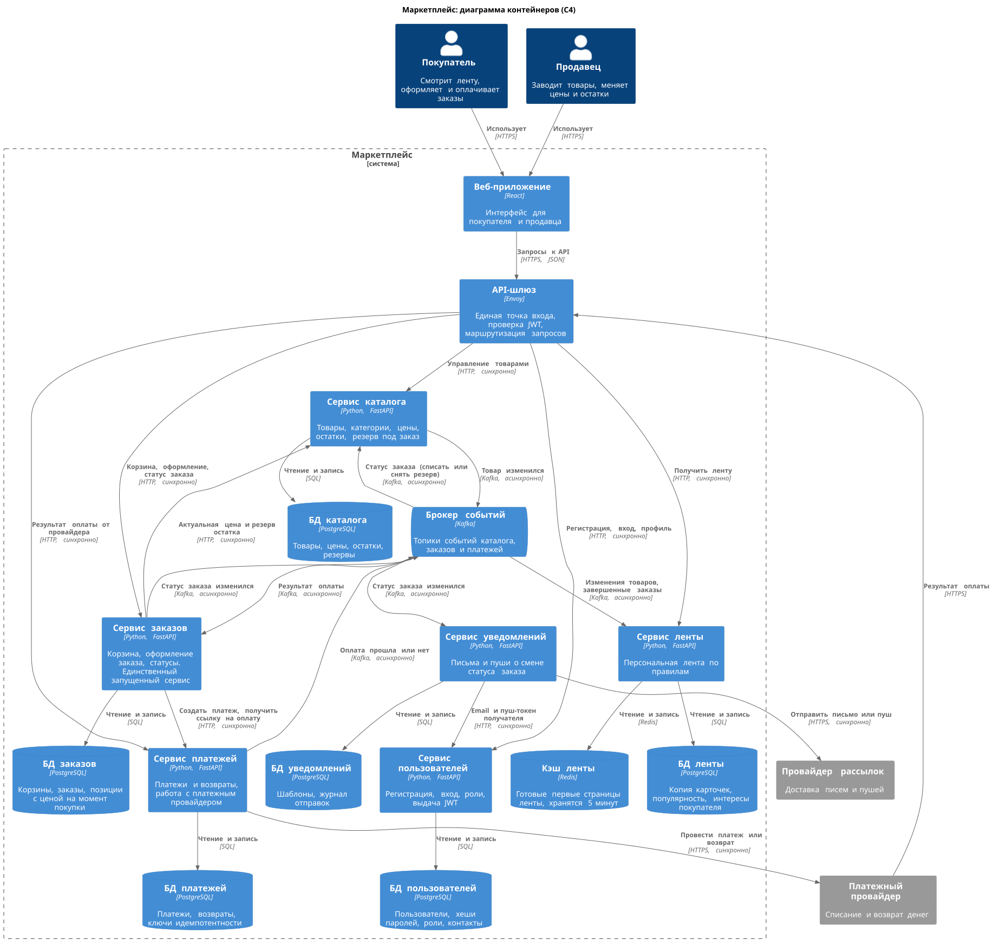

# Маркетплейс: архитектура сервисов

Проект архитектуры маркетплейса: покупатели, продавцы, каталог, персональная лента, заказы, оплата и уведомления. В Docker запускается только сервис заказов, и он умеет отвечать `200 OK` на `GET /health`. Остальные сервисы есть только на диаграмме и в описании ниже.

## Диаграмма C4 (уровень контейнеров)

На диаграмме показаны пользователи, сам маркетплейс, контейнеры внутри него (сервисы, базы, кэш, брокер) и внешние системы. Темно-синие блоки - пользователи, синие - контейнеры маркетплейса (прямоугольники - сервисы, цилиндры - хранилища), серые - внешние системы. У каждого контейнера подписана технология, у каждой связи - что по ней передается и как.

Исходник: [docs/c4-container.puml](docs/c4-container.puml) (C4-PlantUML), картинка: [docs/c4-container.svg](docs/c4-container.svg).



## Домены

| Домен | За что отвечает |
| --- | --- |
| Пользователи | Регистрация, вход, роли (покупатель или продавец), профиль и контакты. После входа выдает JWT-токен. |
| Каталог | Товары продавцов: название, описание, категория, цена, остаток, опубликован или нет. Резервирует остаток под заказ. |
| Лента | Что и в каком порядке показать покупателю. Правила простые: новому покупателю новинки и популярное, остальным сначала товары из категорий и от продавцов, у которых он уже покупал. |
| Заказы | Корзина, оформление и статусы заказа: "ожидает оплаты", "оплачен", "отправлен", "доставлен", "отменен". В позиции заказа сохраняются цена и название на момент покупки. |
| Платежи | Платеж по заказу, возвраты, работа с платежным провайдером. Сами деньги списывает провайдер. |
| Уведомления | Письма и пуши покупателю и продавцу при смене статуса заказа, журнал отправок. |

Корзину не выносил в отдельный домен: она живет недолго и нужна только для того, чтобы из нее сделать заказ. Поиск тоже не выделял, подбором товаров пока занимается лента. Если понадобится полнотекстовый поиск, это будет отдельный сервис, который так же получает изменения товаров через события.

## Как выбирал границы

Домены здесь - это ограниченные контексты в терминах DDD. При выделении границ проверял три вещи: все, что меняется вместе, лежит в одном сервисе (высокий cohesion), сервисам почти не нужно знать друг о друге (низкий coupling), а свои данные сервис прячет внутри и отдает наружу только через API или события.

- Слово "товар" в разных контекстах значит разное. В каталоге это карточка с ценой и остатком, в заказе - снимок цены и названия на момент покупки, в ленте - облегченная копия для показа. Поэтому у каждого контекста своя модель, а не одна общая таблица товаров.
- Платежи работают с чувствительными данными и внешним провайдером, поэтому они отделены от остального. Данные карт у нас не хранятся, их видит только провайдер.
- Сервисы меняются с разной скоростью. Правила ленты будут постоянно подкручивать и экспериментировать с ними, а пользователи и платежи - это учет, там нужна стабильность. Это еще одна причина держать их отдельно.
- Каждый сервис может вести своя команда и выкладывать его независимо от остальных.

## Сервисы и данные

Один домен - один сервис. Кроме них есть веб-приложение, API-шлюз, брокер событий Kafka и Redis для кэша ленты.

У каждого сервиса своя база PostgreSQL, пишет в нее только он сам. На чужие сущности ссылаемся только по id (`seller_id`, `product_id`, `buyer_id`), связей между базами нет.

| Сервис | Какими данными владеет | Как получает чужие данные |
| --- | --- | --- |
| Сервис пользователей | учетные записи, хеши паролей, роли, профили, контакты | сам никуда не ходит |
| Сервис каталога | товары, категории, цены, остатки, резервы | узнает о смене статуса заказа из события, чтобы списать или вернуть резерв |
| Сервис ленты | копия карточек товаров, популярность, интересы покупателя; готовые ленты в Redis | изменения товаров и завершенные заказы приходят событиями |
| Сервис заказов | корзины, заказы, позиции с ценой на момент покупки, история статусов | цену и резерв берет у каталога по HTTP, результат оплаты приходит событием |
| Сервис платежей | платежи, возвраты, ключи идемпотентности | сумму и id заказа передает сервис заказов при создании платежа |
| Сервис уведомлений | шаблоны, журнал отправок | статус заказа приходит событием, email и пуш-токен спрашивает у сервиса пользователей |

JWT проверяет API-шлюз сам по публичному ключу сервиса пользователей, поэтому на каждый запрос в сервис пользователей ходить не нужно.

## Как сервисы общаются

Синхронно значит, что сервис отправляет запрос и ждет ответа. Асинхронно значит, что сервис кладет событие в Kafka и идет дальше, а обработают его позже.

**Синхронно (HTTP)** - там, где ответ нужен сразу:

- Веб-приложение -> API-шлюз -> сервисы пользователей, каталога, ленты, заказов.
- Заказы -> каталог: актуальная цена и резерв остатка при оформлении. Если товар снят с продажи или закончился, заказ не создается.
- Заказы -> платежи: создать платеж и получить ссылку на оплату. Id заказа служит ключом идемпотентности, поэтому повторный запрос не создаст второй платеж.
- Уведомления -> пользователи: email и пуш-токен получателя.
- Платежи -> платежный провайдер, уведомления -> провайдер рассылок.
- Платежный провайдер -> API-шлюз -> платежи: результат оплаты.

**Асинхронно (Kafka)** - там, где можно обработать позже:

| Событие | Кто отправляет | Кто получает и что делает |
| --- | --- | --- |
| Товар изменился | каталог | лента обновляет свою копию карточки |
| Оплата прошла или не прошла | платежи | заказы ставят статус "оплачен" или "отменен" |
| Статус заказа изменился | заказы | уведомления отправляют письмо, лента обновляет интересы покупателя, каталог списывает или возвращает резерв |

Событие сначала записывается в отдельную таблицу исходящих событий в той же транзакции, что и изменение данных, а потом фоновый процесс отправляет его в Kafka. Так событие не потеряется, если сервис упадет сразу после записи в базу. Kafka может доставить событие повторно, поэтому получатели запоминают id обработанных событий и дубли пропускают.

### Пример: оформление заказа

1. Покупатель нажимает "оформить", запрос через API-шлюз приходит в сервис заказов.
2. Сервис заказов идет в каталог, получает актуальную цену и резервирует остаток на 15 минут.
3. Заказ сохраняется со статусом "ожидает оплаты" и с ценой на момент покупки.
4. Сервис заказов вызывает сервис платежей, тот создает платеж у провайдера и возвращает ссылку на оплату.
5. Покупатель платит, провайдер сообщает результат сервису платежей, тот отправляет событие "оплата прошла".
6. Заказ получает статус "оплачен", уходит событие о смене статуса. Каталог списывает резерв, уведомления пишут покупателю и продавцу, лента запоминает категорию и продавца.

Если оплата не прошла или резерв истек, заказ отменяется, а каталог возвращает остаток.

## Варианты разбиения

Домены в обоих вариантах одинаковые, разница в том, как все это запускается и где лежат данные.

**Вариант A. Модульный монолит.** Одно приложение с модулями: пользователи, каталог, лента, заказы, платежи, уведомления. Одна база PostgreSQL, у каждого модуля своя схема. Модули вызывают друг друга обычными функциями. Это разбиение на уровне кода, разворачивается все одним приложением.

**Вариант B. Микросервисы.** Шесть отдельных сервисов, как на диаграмме. У каждого своя база, общаются через HTTP и Kafka.

Вариант "отдельные сервисы, но общая база" не рассматривал: это распределенный монолит. Сеть и ее проблемы в нем уже есть, а независимой выкладки нет, потому что любое изменение схемы задевает всех.

## Плюсы и минусы

| | A. Модульный монолит | B. Микросервисы |
| --- | --- | --- |
| Целостность данных | Заказ, резерв и платеж сохраняются в одной транзакции | Общей транзакции нет, нужны промежуточные статусы, таблица исходящих событий и защита от повторов |
| Нагрузка | Лента и заказы в одном приложении и одной базе, всплеск на ленте тормозит оформление | Ленту можно масштабировать отдельно, заказы и платежи это не задевает |
| Отказы | Если упало приложение, не работает ничего | Лег платежный провайдер - заказы ждут оплату, каталог и лента работают |
| Выкладка | Любая правка требует перевыкладывать все приложение | Каждый сервис выкладывается отдельно |
| Границы данных | Держатся на договоренности, легко начать читать чужие таблицы | Чужую базу прочитать просто нельзя |
| Скорость | Вызовы внутри процесса, быстро | При оформлении заказа два сетевых вызова |
| Актуальность | Данные везде всегда свежие | Лента отстает от каталога на несколько секунд |
| Сеть | Ее между модулями нет | Вызов может упасть или зависнуть, нужны таймауты и повторы (поэтому важна идемпотентность) |
| Безопасность | Модули внутри одного процесса | Внутренней сети тоже нельзя доверять, запросы между сервисами нужно аутентифицировать |
| Контракты | Поменял функцию - компилятор и тесты покажут, что сломалось | API и события нужно менять с обратной совместимостью, иначе сломаются соседние сервисы |
| Наблюдаемость и тесты | Одно приложение, проще мониторинг, отладка и тестирование | Шлюз, Kafka, Redis, шесть баз, нужны метрики, логи и трассировка по всем сервисам, плюс тесты контрактов между ними |
| Стоимость | Дешевле в инфраструктуре и поддержке | Больше серверов, больше настройки, все это стоит денег |

## Почему выбран вариант B

Я выбрал микросервисы. Для маркетплейса главные свойства - доступность и отказоустойчивость: лента и оформление заказа должны работать, даже если что-то одно сломалось.

- Нагрузка очень неравномерная. Лента открывается при каждом заходе покупателя, а заказы и платежи на порядки реже. Ленту можно масштабировать отдельно и кэшировать в Redis, оплату это не затрагивает.
- Ленте не нужна идеальная свежесть, ей хватает своей копии карточек, которая обновляется по событиям. А заказу нужны точная цена и остаток, поэтому он ходит в каталог синхронно.
- Платежи лучше изолировать: работа с деньгами, внешний провайдер, повышенные требования к надежности. Сбой провайдера не должен ронять весь маркетплейс.
- Уведомления ничего не блокируют, поэтому идут асинхронно. Если письмо не отправилось, заказ все равно оплачен.

Главная цена выбора - распределенные транзакции: нет общей транзакции между заказом, резервом и платежом. Это закрывается статусом "ожидает оплаты", резервом с ограниченным сроком, таблицей исходящих событий и защитой от повторной обработки. Оплата и так происходит не мгновенно (покупатель уходит на страницу провайдера), поэтому асинхронный результат здесь подходит.

Монолит был бы лучше для маленькой команды и первой версии продукта с небольшой нагрузкой: быстрее писать и проще поддерживать. Границы модулей в обоих вариантах одинаковые, так что монолит потом можно разрезать на сервисы.

## Что запущено

Запущен только сервис заказов: [services/order-service](services/order-service). Он написан на Python с FastAPI и запускается через uvicorn.

- `GET /health` возвращает `200` и `{"status":"ok"}`.
- Других эндпоинтов нет.
- Базы, Kafka, Redis, шлюз и остальные сервисы в `docker-compose.yml` не описаны, они есть только на диаграмме.

## Как запустить

Нужны Docker и Docker Compose.

Из корня репозитория:

```bash
docker compose up --build
```

Проверить, что сервис работает:

```bash
curl -i http://localhost:8080/health
```

В ответе должна быть строка `HTTP/1.1 200 OK` и тело `{"status":"ok"}`.

Остановить:

```bash
docker compose down
```
